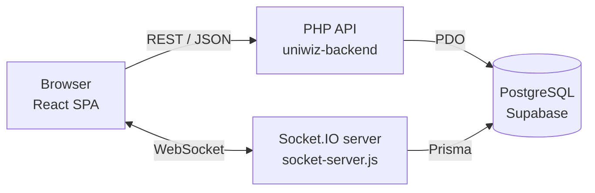

<div align="center">


# UniWiz

**A part-time job portal that connects university students with verified employers.**

[](LICENSE)


[Live demo](https://uni-wiz-parttime.vercel.app) · [Report a bug](../../issues)

</div>

---

## Overview

Students often struggle to find work that fits around lectures, and employers have no easy way to reach motivated, university-verified candidates. UniWiz brings both sides together in one place: employers (publishers) post jobs, students discover and apply to them, and the two can chat in real time and review each other afterwards.

The platform has three roles: **student**, **publisher** and **admin**.

## Features

### Students
- Register with a university email address (validated against known academic domains)
- Browse, search and filter jobs by category, type and keyword; get recommended jobs
- Apply with a proposal and track the status of each application
- Save jobs to a wishlist
- Build a profile with skills, education, languages and a CV upload
- Chat with publishers in real time
- Review companies they have worked for (only after an accepted application)
- Receive in-app notifications

### Publishers
- Post and edit jobs, with pay range, deadline, vacancies, work mode and required skills
- Pay the job-posting fee (simulated checkout: credit card, bank transfer or e-wallet)
- Review applicants, view their profiles and CVs, and accept or reject them
- Close jobs or extend their deadlines
- Maintain a company profile with logo, cover image, gallery and social links
- Review students they have hired
- Dashboard with job, applicant and rating statistics

### Admins
- Manage users: search, filter, verify, block, unblock and delete
- Manage all jobs: approve, reject, close, reopen and delete
- Handle user and app-problem reports
- Read-only conversation viewer for moderation
- Manage job categories and skills, and edit site-wide settings
- Platform statistics dashboard

### Platform
- Role-based access across the UI and API
- Password strength checking and hashed password storage
- Password reset by token
- File uploads for profile images, CVs, company covers, gallery images and documents
- Responsive UI built mobile-first with Tailwind CSS

## Tech stack

| Layer | Technology |
|---|---|
| Frontend | React 18, Tailwind CSS 3, Framer Motion, Create React App |
| REST API | PHP 8.1+ (PDO), Composer, `vlucas/phpdotenv`, PHPMailer |
| Real-time chat | Node.js, Express 5, Socket.IO 4 |
| Database | PostgreSQL (Supabase), Prisma 6 for schema, migrations and seeding |
| Hosting | Vercel (frontend), Render (API and chat server), Supabase (database) |

## Architecture



The React app calls the PHP API for all data operations. Chat messages go through the Socket.IO server, which stores them in the same database through Prisma.

## Project structure

```
UniWiz_Parttime/
├── uniwiz-frontend/        React app
│   └── src/
│       ├── components/     Pages and UI (admin/ holds the admin screens)
│       ├── utils/          Validators, socket client, helpers
│       └── config.js       API base URL (REACT_APP_API_URL)
├── uniwiz-backend/         PHP REST API
│   ├── api/                One endpoint per file (auth, jobs, applications, ...)
│   ├── classes/            Domain classes (users, business, core)
│   └── config/database.php Database connection
├── prisma/
│   ├── schema.prisma       Data model (18 tables)
│   ├── supabase_schema.sql Equivalent plain-SQL schema
│   └── seed.js             Demo data
├── socket-server.js        Real-time chat server
├── Dockerfile              Container image for the PHP API (used by Render)
├── render.yaml             Render blueprint (API + chat server)
└── start-*.bat, dev.bat    Windows launcher scripts
```

## Getting started

### Prerequisites

- Node.js 18 or newer
- PHP 8.1 or newer with the `pdo_pgsql` extension enabled
- [Composer](https://getcomposer.org/)
- A PostgreSQL database. A free [Supabase](https://supabase.com/) project works well.

### 1. Install dependencies

```bash
git clone https://github.com/chandhim/UniWiz_Parttime.git
cd UniWiz_Parttime

npm install                              # root: Prisma, Socket.IO server
cd uniwiz-frontend && npm install && cd ..
cd uniwiz-backend && composer install && cd ..
```

### 2. Configure environment variables

Copy the example file and fill in your database details:

```bash
cp .env.example .env
```

Both the PHP API and Prisma read the `.env` file in the repository root. See [Environment variables](#environment-variables) for what each value does.

### 3. Set up the database

Create the tables from the Prisma schema, then optionally load demo data:

```bash
npm run prisma:generate
npm run prisma:push      # create tables
npm run prisma:seed      # optional: demo users, jobs, reviews and messages
```

If you prefer plain SQL, run [`prisma/supabase_schema.sql`](prisma/supabase_schema.sql) in the Supabase SQL editor instead of `prisma:push`.

The seed script creates demo accounts for each role. Their shared development password is set in [`prisma/seed.js`](prisma/seed.js). Do not seed a production database.

### 4. Run the app

```bash
npm run dev
```

This starts three processes together:

| Service | URL |
|---|---|
| React frontend | http://localhost:3000 |
| PHP API | http://uniwiz-backend.test/api (served on `127.0.0.1:80`) |
| Socket.IO chat | http://localhost:4000 |

The frontend defaults to `http://uniwiz-backend.test/api`. Either add this line to your hosts file:

```
127.0.0.1  uniwiz-backend.test
```

or skip the hosts entry and set `REACT_APP_API_URL=http://127.0.0.1/api` for the frontend. Port 80 needs elevated rights on some systems. To use another port, change the port in the `start:backend` script and in `REACT_APP_API_URL`.

You can also start each service on its own with `npm run start:backend`, `npm run start:socket` and `npm run start:frontend`. On Windows, `start-project.bat` opens each one in a separate window.

## Environment variables

| Variable | Used by | Description |
|---|---|---|
| `DATABASE_URL` | PHP API, Prisma | Pooled connection string (Supabase port 6543) |
| `DIRECT_URL` | PHP API, Prisma | Direct connection string (port 5432), needed for schema push and migrations |
| `FRONTEND_URL` | PHP API | Allowed CORS origin. Defaults to `http://localhost:3000` |
| `APP_DEBUG` | PHP API | Set to `true` to show PHP errors while developing. Leave unset in production |
| `APP_ENV` | PHP API | Set to `development` to allow the dev-only seed and setup scripts over HTTP |
| `SOCKET_PORT` | Socket server | Port for the chat server. Defaults to `4000` |
| `REACT_APP_API_URL` | Frontend (build time) | Base URL of the PHP API, ending in `/api` |
| `REACT_APP_SOCKET_URL` | Frontend (build time) | URL of the chat server. Defaults to `http://localhost:4000` |

Never commit your `.env` file. It is already in `.gitignore`.

## Available scripts

Run from the repository root unless noted.

| Command | What it does |
|---|---|
| `npm run dev` | Start the API, chat server and frontend together |
| `npm run prisma:push` | Push the Prisma schema to the database |
| `npm run prisma:seed` | Load demo data |
| `npm run prisma:studio` | Open Prisma Studio to browse the data |
| `npm run build:frontend` | Production build of the React app |
| `npm test` (in `uniwiz-frontend/`) | Run the frontend test suite |
| `npm run build:css` (in `uniwiz-frontend/`) | Rebuild `src/output.css` after changing Tailwind classes |

`uniwiz-frontend/src/output.css` is a compiled file that is committed to the repository. Run `npm run build:css` in `uniwiz-frontend/` after adding new Tailwind classes, or run `npm run start:with-css` in `uniwiz-frontend/` to rebuild it automatically while developing.

## Deployment

| Part | Platform | Notes |
|---|---|---|
| Frontend | Vercel | Set the root directory to `uniwiz-frontend`. Add `REACT_APP_API_URL` and `REACT_APP_SOCKET_URL`. |
| PHP API | Render (Docker) | Defined in `render.yaml`. Set `DATABASE_URL`, `DIRECT_URL` and `FRONTEND_URL`. |
| Chat server | Render (Node) | Defined in `render.yaml`. Set `DATABASE_URL` and `DIRECT_URL`. |
| Database | Supabase | Create the schema with `prisma db push` or the SQL file. |

Before deploying the chat server, add your deployed frontend origin to the `cors.origin` list in [`socket-server.js`](socket-server.js). It currently allows localhost origins only.

If you are upgrading a database created from an older `supabase_schema.sql`, run [`prisma/migration_2026_11_fix_job_status_closed.sql`](prisma/migration_2026_11_fix_job_status_closed.sql) once to add the `closed` job status.

## Notes

- The job-posting checkout is a **simulated payment flow** for demonstration. It does not charge real money.
- Accounts are verified automatically at registration, so there is no email confirmation step. Student sign-ups must still use a university email address. Admins can verify or unverify users afterwards.

## License

Released under the [MIT License](LICENSE). Copyright (c) 2026 Manula Chandupa.
